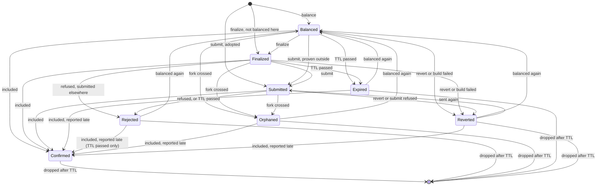

# One lifecycle record per transaction, from balancing to its final state

- Status: proposed
- Deciders: Ian Gregson
- Date: 2026-11-03

Technical Story: [#847](https://github.com/midnightntwrk/midnight-wallet/issues/847) — the pending-transactions service
keeps two records for one spend, and neither says where the transaction is.

## Context and Problem Statement

The pending-transactions service holds two kinds of record. A **reservation** stands for a balanced transaction that has
not been submitted: its identifiers, intent hashes, the coins it booked and a TTL, but never the transaction, because an
unproven transaction carries secrets ([ADR-0009](0009-unshielded-bookings-persist-and-expire.md)). A **pending item**
stands for a transaction being polled against the indexer. Registering a pending item drops the reservation that shares
an identifier with it, and `coveredUnshieldedIds` reads both lists to know which coins are spoken for. One spend, two
records, and a hand-off between them that nothing names.

That split leaves several things wrong or missing:

- `finalizeTransaction` registers its result as a pending item, so `FacadeState.pending` shows a transaction that was
  finalized and never submitted as `Submitted`, with its finalize time as `submittedAt`.
- A reservation carries no protocol version, so a fork cannot orphan it; its coins wait out the TTL.
- A transaction proven through `facade.provingService` or an outside prover has no record until it is submitted.
- `Confirmed` is a public status that is never shown: the poller drops an included transaction at once. The pending set
  therefore never learns of an inclusion, which is why a late rejection needs a precedence rule to stop it overruling
  one.
- A stored item holds only its transaction, creation time and protocol version, so a restart forgets a `Rejected` or
  `Orphaned` verdict and polls again.
- "Pending transactions" no longer describes a service that would hold transactions before submission and after their
  outcome.

How should the SDK record a transaction from the moment it is balanced to the moment nothing can change its outcome?

## Decision Drivers

- Never write a secret to storage: no unproven transaction, no proof preimage.
- One releaser per wallet ([ADR-0009](0009-unshielded-bookings-persist-and-expire.md),
  [ADR-0010](0010-shielded-bookings-expire-in-the-wallet.md)): a record decides what is held, never what is freed.
- A recorded inclusion is final: no later verdict overrules it.
- Every stored format version shipped stable keeps loading ([ADR-0008](0008-persisted-format-versioning.md)).
- The store stays bounded.
- A fork must be able to give up on any transaction it strands, whatever state it is in.

## Considered Options

- One lifecycle record per transaction, in a service renamed for what it holds.
- Keep two records, and split them into a reservations service and a pending-transactions service.
- Keep the shape and rename only.

## Decision Outcome

Chosen option: **one lifecycle record per transaction**, because it is the only option that gives every transaction one
place that says where it is, and it absorbs every gap above as a property of the record rather than a guard at a call
site.

### States

| State       | Entered from                                                                                   | Entered by                                                                                                                                                                                         | The record stores              |
| ----------- | ---------------------------------------------------------------------------------------------- | -------------------------------------------------------------------------------------------------------------------------------------------------------------------------------------------------- | ------------------------------ |
| `Balanced`  | nothing                                                                                        | `transferTransaction`, `initSwap`, `balanceFinalizedTransaction`, `balanceUnboundTransaction`, `balanceUnprovenTransaction`, `registerNightUtxosForDustGeneration`, `deregisterFromDustGeneration` | the transaction, proofs erased |
| `Finalized` | `Balanced`, or nothing                                                                         | `finalizeTransaction`, `finalizeRecipe`; a transaction the facade did not balance enters here                                                                                                      | the finalized transaction      |
| `Submitted` | `Balanced`, `Finalized`, `Reverted`, or nothing                                                | `submitTransaction`; an adopted transaction, or one proven outside the facade, enters here; a reverted one sent again re-enters                                                                    | the finalized transaction      |
| `Confirmed` | `Balanced`, `Finalized`, `Submitted`; `Expired`, `Rejected` at its TTL, `Orphaned`, `Reverted` | its inclusion, from sync or the poller, whoever submitted it; reported late, it overrules an end the wallet only inferred                                                                          | unchanged                      |
| `Rejected`  | `Finalized`, `Submitted`                                                                       | the chain refused it, whoever submitted it, or its TTL passed while submitted                                                                                                                      | unchanged, with the verdict    |
| `Orphaned`  | `Balanced`, `Finalized`, `Submitted`                                                           | the wallets crossed past the epoch it was built for                                                                                                                                                | unchanged, with the verdict    |
| `Expired`   | `Balanced`, `Finalized`                                                                        | its TTL passed before it was submitted                                                                                                                                                             | unchanged                      |
| `Reverted`  | `Balanced`, `Finalized`, `Submitted`                                                           | `revert`, `revertTransaction`, a builder that failed part-way, a submission that failed in a way proving no block holds it                                                                         | unchanged                      |

`Confirmed`, `Rejected`, `Orphaned`, `Expired` and `Reverted` are final: no other verdict moves them. Three ways out
remain. Balancing the same spend again, whose coins were never spent on chain, replaces a `Rejected`, `Orphaned`,
`Expired` or `Reverted` record with a new `Balanced` one, so a spend keeps one record. Sending a reverted transaction
again, as a caller does after a submission that threw, moves it to `Submitted`: once sent it is in flight, whatever the
wallet concluded before. And an inclusion reported after the wallet ended a record by its own inference (`Expired`,
`Rejected` because its TTL passed, `Orphaned`, `Reverted`) moves it to `Confirmed`: a block's time is within the
transaction's TTL, so the inclusion happened first and sync only saw it late. An inference gives way to a fact. A
`Rejected` the chain reported is itself an inclusion and stays. Sync reports an inclusion through the history storage
the wallets write into, which the facade wraps so that each write, once stored, moves the record. A partial success sync
reports moves nothing: the history keeps no segments, and which segments failed decides what is released, so the poller
settles it. Whatever was released at the inferred end is harmless, because sync settles the spent coins. `Confirmed` is
final against every other verdict, which replaces the precedence rule a late rejection needed: once the record knows of
the inclusion, nothing moves it. A finalized record takes the chain's refusal as a submitted one does, because another
party may have submitted it, as in a swap; a balanced one cannot have reached a chain. The four status names
`FacadeState.pending` published keep their meaning, except that a partial success, which `Rejected` covered, is now
`PartialSuccess`; the other five are added. `FacadeState.lifecycle` is one entry per record, read off it.
`PartialSuccess` carries the segments the chain reported: the chain included the transaction and applied some of it, so
it is not a transaction that never happened. `Rejected` says why: `Refused`, with the segments the chain reported, or
`TTLPassed`, which has none. `Confirmed` carries no segments, because the record keeps none. An entry holds its
finalized transaction from `Finalized` on, and none while `Balanced` or once a record that was only ever balanced has
ended: its transaction is still the erased form, which is no finalized transaction. The facade keeps which form it holds
beside the transaction. Since an ended record stays until its TTL passes, an empty list no longer means nothing is
awaited: `isAwaiting` tells the balanced, finalized and submitted entries from the ended ones.

**No transition frees a coin.** Each wallet's own sweep and the facade's release-on-failure stay the only releasers, as
ADR-0009 and ADR-0010 have them. A record moving to `Expired` or `Reverted` says the coins are no longer spoken for,
which is what `coveredUnshieldedIds` reads; it does not hand them back. Dust is the one exception at `Expired`. The
shielded and unshielded wallets sweep a booking when its TTL passes, but the Dust wallet holds a spend until the Dust
grace period after the spend's own time runs out, hours later. So when a balanced or finalized record expires, the
facade releases that record's Dust booking, and only that: the Dust wallet matches a booking by nullifier and the
spend's time, so it cannot free a coin another transaction has booked since.

### What a record carries

- **The transaction's own protocol version, at every state.** The version the transaction's bytes were built for, never
  the version the wallets last reported. A fork then orphans a `Balanced` ledger-v8 record exactly as it orphans a
  submitted one, and a transaction submitted before all three wallets have reported a version is still given up on.
- **The transaction, in the form for its state.** `Balanced` stores `tx.eraseProofs()`; `Finalized` onwards store the
  finalized transaction, which holds no secret.
- **Its inputs, per wallet**, as the reservation does today. They are derivable from the stored transaction, but a
  record upgraded from a stored reservation has no transaction to derive them from (see Stored format).
- **Its TTL**, read off the transaction by the trait registered for its version, by the one rule the wallet already
  expires transactions with: the earliest TTL of its intents, which is when the ledger stops accepting it; and, when it
  spends Dust, carries shielded offers or has no intent at all, the Dust grace period after the record began if that
  comes first. That backstop is what ends a rewards or bridge claim, which has no intent and which the indexer never
  reports. No record takes the caller's TTL: a reservation records it today, which can differ from the one the
  unshielded wallet booked with, and neither finalizing nor restoring has one to give.
- **When it was submitted**, set on entering `Submitted` and kept through whatever verdict follows, so a `Confirmed` or
  `Rejected` record still says when it was sent. A record never submitted has none.
- **Its state and verdict**, so a restart shows what the store showed before it stopped, without polling again.

### Why the erased form is safe to store

An unproven transaction serializes every proof preimage: coin secret keys, the Dust secret key, coin nonces and values,
Merkle paths, contract witnesses. ADR-0009 is right that it must never be written. `eraseProofs()` drops all of them and
keeps what the ledger needs to name the spend: nullifiers, value and coin commitments, unshielded offers, Dust actions,
TTLs. Checked by proving real transactions on both installed ledgers (ledger-v8 8.1.0, ledger-v9 1.0.0-rc.6), with
shielded and unshielded inputs in the guaranteed and a fallible segment and a Dust spend: identifiers, intent hashes and
every input are equal across the unproven, erased, proven and bound forms; the erased form round-trips byte for byte and
its header carries no proof-preimage marker. A record is therefore keyed and reconciled exactly as the transaction it
stands for. `mockProve` is not a substitute: it changes identifiers and intent hashes.

The erased form cannot be submitted or proven again. It is a record, not a way to resume a build.

### Retention

A final record stays in the store, in its final state, until its transaction's TTL has passed, and is dropped on the
next sweep after that. Once the TTL has passed no chain can include the transaction, so no verdict can arrive that
conflicts with the one recorded, and the poller has nothing left to ask about it. `Confirmed` is therefore visible for
the rest of the transaction's lifetime, and the store holds at most a lifetime of finished transactions.

A record that is final _because_ its TTL passed, `Expired` or `Rejected` at TTL, is published once in that state and
dropped by the same sweep. The transaction history stays the durable record of anything that was submitted.

### Stored format

The store moves from `v1` to `v2` under [ADR-0008](0008-persisted-format-versioning.md), with its version constants and
the one upgrade step in a ledger-free `transactionLifecycle/SnapshotFormat.ts`, as the snapshot surfaces have. The step
fills in, never invents:

- A `v1` reservation becomes a `Balanced` record with no transaction, keeping its identifiers, intent hashes, inputs and
  TTL; one already marked expired becomes `Expired`. Its version is unknown, so a fork never orphans it; its TTL still
  ends it.
- A `v1` pending item becomes a `Submitted` record, as `FacadeState.pending` showed it, keeping its transaction,
  creation time and protocol version. It has no submission time: `v1` kept only when it was finalized. Its identifiers,
  intent hashes, inputs and TTL were never stored, so the reader takes them from the transaction, through the trait
  registered for its version; an item stored before transactions were stamped is read with the oldest trait and keeps
  its version unknown, so a fork never orphans it. A `v2` writer stores all four on every record, and the reader takes a
  stored fact over one read off the transaction. `v1` stored no verdicts, so none carries over; the poller asks again.
- Unknown top-level fields are carried through, as every reader of this store already does.

### Name

The service becomes **`TransactionLifecycleService`**. It is not named after reservations, which ADR-0009 and ADR-0010
use for one state, nor after pending transactions, which it now holds only some of. The rename ships in the major
releases already on their way in the changesets pre-release, so stable users meet one break either way; the old names
are not kept as deprecated aliases, and the changesets carry an old-to-new name table instead. Everything named after
the old service follows: the `capabilities` module and subpath become `transactionLifecycle`, its trait helpers
`TransactionTraits`, and the facade view `FacadeState.pending` becomes `FacadeState.lifecycle`, of `LifecycleEntry`
values with a `LifecycleStatus` each, read by `lifecycleEntriesOf`.

### Positive Consequences

- One record says where a transaction is. `finalizeTransaction` shows `Finalized`, and `submittedAt` is the submission
  time.
- A fork gives up on a stranded transaction in any state, not only once submitted.
- `Confirmed` is shown, and an inclusion is final by construction rather than by a precedence rule.
- A restart keeps every verdict.
- The six booking sites ADR-0009 counted no longer each register a reservation by hand: each moves a record into
  `Balanced`, one operation in one place.

### Negative Consequences

- A breaking change for anyone who implements or calls the service directly, and for `FacadeState.pending`, renamed
  `FacadeState.lifecycle`: a major release of `capabilities` and `facade`, and of `wallet-sdk` for its barrels.
- The store writes `v2`, which an earlier release refuses. Downgrading after this release has written the store loses
  the pending set, not coins: each wallet's own bookings and sweep are untouched.
- Stored records grow: a `Balanced` record now holds an erased transaction where a reservation held a few ids.
- A record upgraded from a `v1` reservation carries no version, so it waits out its TTL across a fork rather than being
  orphaned, as it does today.
- Retention by TTL means an application that polls `FacadeState` rather than subscribing can miss an `Expired` or TTL
  `Rejected` state.

## Pros and Cons of the Options

### One lifecycle record per transaction

- Good, because every gap above becomes a property of the record: the version stamp, the `Finalized` state, the
  orphaning of an unsubmitted transaction, the persisted verdict.
- Good, because it keeps the release rule of ADR-0009 and ADR-0010 unchanged: records hold, wallets free.
- Bad, because it is a stored-format change and a public rename at once.

### Split into a reservations service and a pending-transactions service

- Good, because each service would have one job and no rename of the existing one.
- Bad, because the hand-off between them stays implicit, now across two services, and `coveredUnshieldedIds` would have
  to read both.
- Bad, because it fixes none of the gaps: no version on a reservation, no `Finalized`, no persisted verdict.

### Rename only

- Good, because it is cheap and settles the naming complaint.
- Bad, because it leaves every behavioural gap where it is.

## Links

- Refines [ADR-0009](0009-unshielded-bookings-persist-and-expire.md) — a reservation becomes the `Balanced` state of a
  lifecycle record, and holds the erased transaction, which ADR-0009's rule against storing an unproven transaction
  allows. Its release rule is unchanged.
- Refines [ADR-0010](0010-shielded-bookings-expire-in-the-wallet.md) — the record of a shielded booking moves into the
  same lifecycle; the shielded wallet's sweep stays its only releaser.
- Constrained by [ADR-0008](0008-persisted-format-versioning.md) — the store's `v1` → `v2` upgrade.
